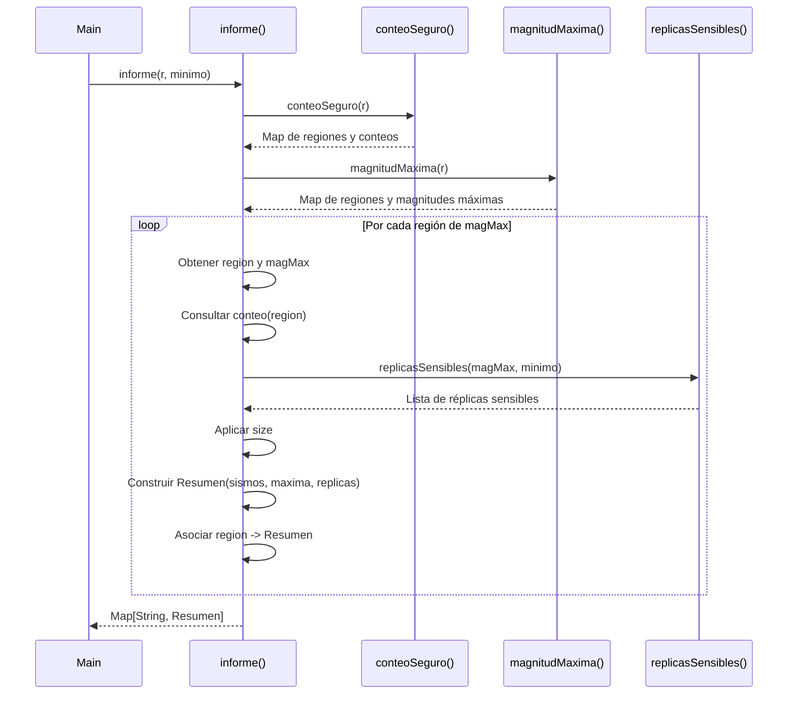
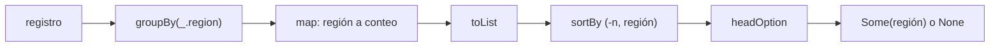
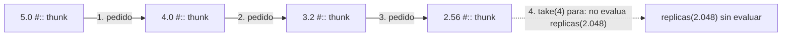
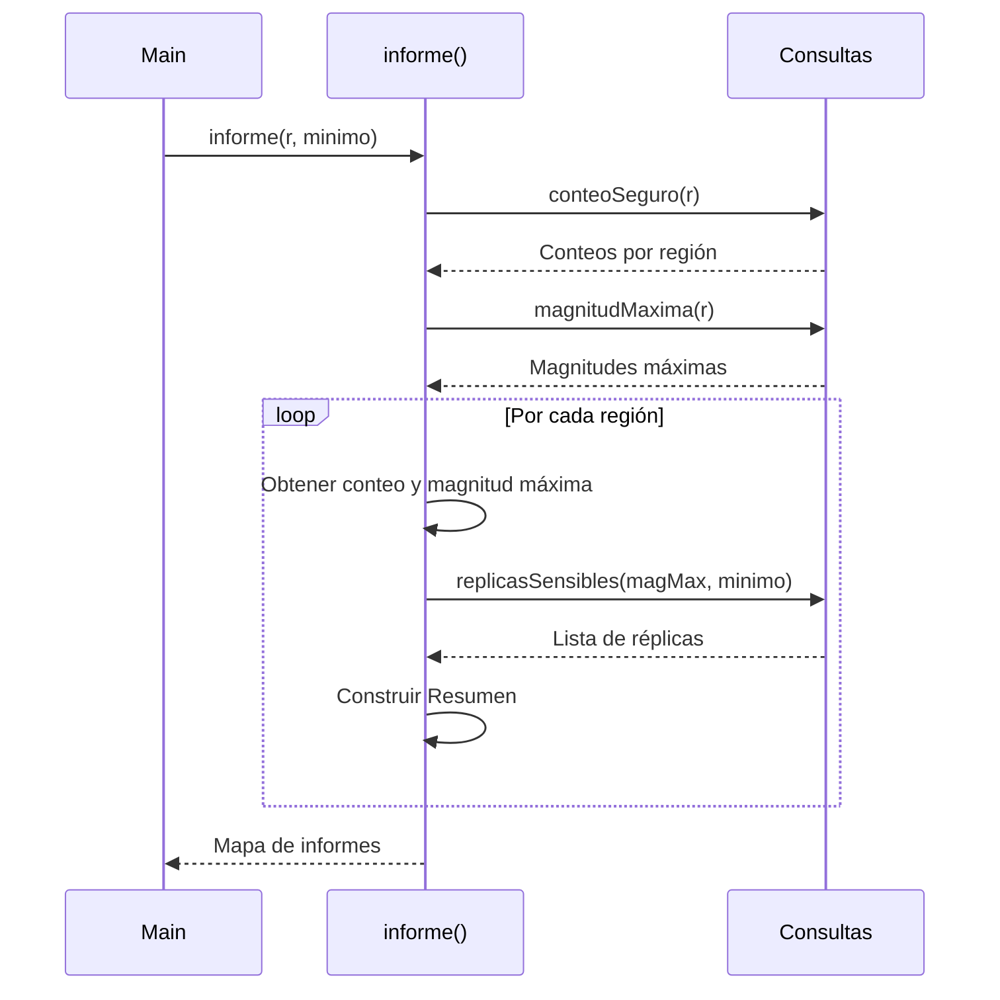

# Informe de Proceso - Taller 3

Fundamentos de Programación Funcional y Concurrente  
Universidad del Valle

## Punto 1: Consultas con Expresiones For

### Definición del Algoritmo - `fuertes`
```scala
def fuertes(r: Registro, umbral: Double): List[String] = {
   for {
      reg <- r 
      if reg.magnitud > umbral
   } yield reg.region
}
``` 
La función fuertes recibe un registro `r` y un valor `umbral`. Obtiene las regiones con magnitud superior al umbral establecido y las devuelve en un `List[String]`.

Recibe dos parametros:

- r: Registros que se desea consultar.
- umbral: Valor de magnitud que debe superarse.

### Definición del Algoritmo - `enRegion`
```scala
def enRegion(r: Registro, region: String): List[Double] = {
   for {
      reg <- r
      if reg.region.indexOf(region) >= 0
   } yield reg.magnitud
}
``` 
La función recibe un registro `r` y un string `region`. Obtiene las magnitudes de los registros donde la región sea igual al parametro `region` y devuelve los valores obtenidos en un `List[Double]`.

Recibe dos parametros:
- `r`: Registros a consultar.
- `region`: Nombre de la región para la consulta.

### Definición del Algoritmo - `paresCercanos`
```scala
def paresCercanos(r: Registro, dif: Double): List[(String, String)] = {
   val ordenRegiones = (for(reg <- r) yield reg.region).distinct

   (for{
      x <- ordenRegiones
      xs <- ordenRegiones.dropWhile(_ != x).drop(1)

      reg1 <- r if x == reg1.region
      reg2 <- r if xs == reg2.region

      if (reg1.magnitud - reg2.magnitud).abs <= dif
   }yield (reg1.region, reg2.region)).distinct
}
``` 
La función recibe un registro `r` y un double, `dif`, para la diferencia máxima entre magnitudes. Esta encuentra parejas de regiones distintas con registros que tengan una diferencia entre sus magnitudes menor o igual al parametro establecido.

Recibe dos parametros:

`r`: Registros a consultar.
`dif`: Diferencia máxima permitida entre las magnitudes de dos registros.

### Explicación Paso a Paso
#### `fuertes( )`
- Se utiliza una expresión for para recorrer todos los elementos de `r`.
- En cada iteración, se obtiene un registro mediante `reg <- r`.
- Se aplica el filtro `if reg.magnitud > umbral`, para continuar unicamente con los registros con magnitud mayor al umbral.
- Finalmente, con `yield reg.region` se obtiene la región de cada registro que cumple con la condición.
#### `enRegion( )`
- Se recorren los registros mediante `reg <- r`.
- Se utiliza `reg.region.indexOf(region) >= 0` para comprobar si el registro contiene el valor del parametro `region`.
- Si `indexOf` encuentra el texto, devuelve una posición mayor o igual a cero. En caso contrario, devuelve -1.
- Mediante `yield reg.magnitud`, se obtienen las magnitudes de cada registro que cumple la condición.
#### `paresCercanos( )`
1. Se construye una lista con las regiones sin repetir y en el orden en que aparecen en el registro:

```scala
val ordenRegiones = (for(reg <- r) yield reg.region).distinct
```
- Se recorre el registro utilizando una expresión for.
- Con `yield reg.region` se obtiene el nombre de cada región.
- Se aplica `distinct` para eliminar las regiones repetidas.

2. Luego se utiliza otra expresión for para generar las parejas utilizando la lista `ordenRegiones`:

- `x <- ordenRegiones`: selecciona una región de la lista.
- `xs <- ordenRegiones.dropWhile(_ != x).drop(1)`: obtiene las regiones que aparecen después de x, utlizando `dropWhile` y `drop(1)` para evitar generar parejas repetidas o parejas de una región consigo misma.
- `reg1 <- r if x == reg1.region`: busca los registros correspondientes a la primera región.
- `reg2 <- r if xs == reg2.region`: busca los registros correspondientes a la segunda región.
- `if (reg1.magnitud - reg2.magnitud).abs <= dif`: comprueba que la diferencia absoluta entre las magnitudes sea menor o igual al límite establecido.
- `yield (reg1.region, reg2.region)`: construye una pareja con las dos regiones que cumplen la condición.
- Al final se utiliza `distinct` para eliminar las parejas duplicadas del resultado.

### Traducción de For Expressions
#### `fuertes( )`
```scala
for {
   reg <- r 
   if reg.magnitud > umbral
} yield reg.region
```
```math
\downarrow
```
```scala
r.withFilter(reg => reg.magnitud > umbral).map(reg => reg.region)
```
---
### `enRegion( )`
```scala
for {
   reg <- r
   if reg.region.indexOf(region) >= 0
} yield reg.magnitud
```
```math
\downarrow
```
```scala
r.withFilter(reg => reg.region.indexOf(region) >= 0).map(reg => reg.magnitud)
```
---
### `paresCercanos( )`
```scala
val ordenRegiones = (for(reg <- r) yield reg.region).distinct

for{
   x <- ordenRegiones
   xs <- ordenRegiones.dropWhile(_ != x).drop(1)

   reg1 <- r if x == reg1.region
   reg2 <- r if xs == reg2.region

   if (reg1.magnitud - reg2.magnitud).abs <= dif
}yield (reg1.region, reg2.region)).distinct   
```
```math
\downarrow
```
```scala
val ordenRegiones = r.map(_.region).distinct

ordenRegiones.flatMap(x =>
   ordenRegiones.dropWhile(_ != x).drop(1).flatMap(xs =>
      r.withFilter(reg1 => x == reg1.region).flatMap(reg1 =>
         r.withFilter(reg2 => xs == reg2.region).withFilter(reg2 =>
         (reg1.magnitud - reg2.magnitud).abs <= dif).map(reg2 =>(reg1.region, reg2.region))
      )
   )
).distinct
```
### Diagrama de Llamados

---
## Punto 3: consultas seguras

Código del punto (en `RegistroSismico.scala`):

```scala
def conteoSeguro(r: Registro): Map[String, Int] =
  r.groupBy(_.region).map { case (region, sismos) => (region, sismos.length) }
    .withDefaultValue(0)

def maximaDe(r: Registro, region: String): Option[Double] =
  (for (s <- r if s.region == region) yield s.magnitud).maxOption

def regionMasActiva(r: Registro): Option[String] =
  r.groupBy(_.region).map { case (region, sismos) => (region, sismos.length) }
    .toList.sortBy { case (region, n) => (-n, region) }
    .headOption.map { case (region, _) => region }
```

Las tres funciones evitan las excepciones de dos maneras: `conteoSeguro` le da
al mapa un valor por defecto, y `maximaDe` y `regionMasActiva` devuelven un
`Option` en lugar de fallar cuando no hay respuesta. No se usa `var`, `while`
ni `return`.

### Traducción de la expresión `for` de `maximaDe`

El `for` con `if` y `yield` no es una construcción propia: el compilador la
traduce a `withFilter` y `map`.

```scala
for (s <- r if s.region == region) yield s.magnitud
```

se traduce a

```scala
r.withFilter(s => s.region == region).map(s => s.magnitud)
```

El guarda `if` pasa a `withFilter` y el `yield` pasa a `map`. Después,
`maxOption` toma la lista de magnitudes: si está vacía devuelve `None` y si no
lo está devuelve `Some` del mayor.

### Traza de `conteoSeguro(registro)`

Con el registro de siete sismos del material:

1. `r.groupBy(_.region)` agrupa los sismos por región:

   | región | sismos del grupo |
      |---|---|
   | `"Valle"` | 3 sismos (4.2, 3.8, 5.3) |
   | `"Santander"` | 2 sismos (5.1, 4.7) |
   | `"Choco"` | 2 sismos (6.0, 3.1) |

2. `.map { case (region, sismos) => (region, sismos.length) }` reemplaza cada
   grupo por su tamaño: `Map("Valle" -> 3, "Santander" -> 2, "Choco" -> 2)`.
3. `.withDefaultValue(0)` envuelve ese mapa. Las claves que están siguen
   respondiendo su conteo, y toda clave que no está responde `0` en lugar de
   lanzar `NoSuchElementException`.

Entonces `conteoSeguro(registro)("Valle")` da `3` y
`conteoSeguro(registro)("Amazonas")` da `0`. El valor por defecto solo actúa
con `apply`: `contains("Amazonas")` sigue siendo `false`, porque la clave no
se agrega al mapa.

### Traza de `maximaDe(registro, "Choco")` y `maximaDe(registro, "Amazonas")`

| llamada | magnitudes de la región (`for`) | `maxOption` |
|---|---|---|
| `maximaDe(registro, "Choco")` | `List(6.0, 3.1)` | `Some(6.0)` |
| `maximaDe(registro, "Amazonas")` | `List()` | `None` |

### Traza de `regionMasActiva(registro)`

1. Se agrupa y se cuenta como en `conteoSeguro`, y se pasa a lista de parejas.
   El orden de esa lista no está garantizado por el mapa, por ejemplo:
   `List(("Santander", 2), ("Valle", 3), ("Choco", 2))`.
2. `sortBy { case (region, n) => (-n, region) }` ordena por conteo
   descendente (por eso el signo menos) y, en empate, por nombre ascendente:
   `List(("Valle", 3), ("Choco", 2), ("Santander", 2))`.
3. `headOption` toma la primera pareja, `Some(("Valle", 3))`, y la última
   transformación se queda con el nombre: `Some("Valle")`.

Con el registro vacío no hay grupos, la lista está vacía y `headOption` da
`None`.




---

## Punto 4: réplicas perezosas

Código del punto (en `RegistroSismico.scala`):

```scala
def redondear(x: Double): Double = Math.round(x * 100.0) / 100.0

def replicas(magnitud: Double): LazyList[Double] =
  redondear(magnitud) #:: replicas(magnitud * 0.8)

def replicasSensibles(magnitud: Double, minimo: Double): List[Double] =
  replicas(magnitud).takeWhile(_ > minimo).toList
```

Ninguna función usa `var`, `while` ni `return`. La recursión de `replicas` no usa
una expresión `for`, sino el constructor perezoso `#::` de `LazyList`.

### ¿Cómo funciona `redondear`?

Multiplica el valor por `100.0`, redondea al entero más cercano con `Math.round`
y vuelve a dividir por `100.0`. Así conserva exactamente dos cifras decimales
(por ejemplo, `redondear(4.352) = 4.35`).

### Traza paso a paso de `replicas(5.0).take(4).toList`

El operador `#::` (`LazyList.cons`) recibe su segundo argumento **por nombre**
(*call-by-name*). Eso significa que la llamada recursiva `replicas(magnitud * 0.8)`
queda guardada como una promesa sin evaluar (*thunk*) hasta que el consumidor
pida explícitamente el siguiente elemento:

1. **Paso 0 (creación inicial):** `replicas(5.0)` construye la celda con cabeza
   `redondear(5.0) = 5.0` y cola suspendida `replicas(4.0)` (aún no se llama).
2. **`take(4)` pide el 1.er elemento:** entrega `5.0` (quedan 3 por pedir) y
   fuerza la cola `replicas(4.0)`.
3. **`take(4)` pide el 2.º elemento:** `replicas(4.0)` calcula `redondear(4.0) = 4.0`
   con cola suspendida `replicas(3.2)`. Entrega `4.0` (quedan 2 por pedir).
4. **`take(4)` pide el 3.er elemento:** `replicas(3.2)` calcula `redondear(3.2) = 3.2`
   con cola suspendida `replicas(2.56)`. Entrega `3.2` (queda 1 por pedir).
5. **`take(4)` pide el 4.º elemento:** `replicas(2.56)` calcula `redondear(2.56) = 2.56`
   con cola suspendida `replicas(2.048)`. Entrega `2.56` (quedan 0 por pedir).
6. **Detención:** Como el contador de `take(4)` llega a cero, nunca se fuerza
   `replicas(2.048)`. Finalmente, `.toList` materializa `List(5.0, 4.0, 3.2, 2.56)`.

| Paso | Magnitud sin redondear | Valor emitido (`redondear`) | Cola suspendida | ¿Se evalúa? |
|---|---|---|---|---|
| 1 | `5.0` | `5.0` | `replicas(4.0)` | Sí (pedida por `take`) |
| 2 | `4.0` | `4.0` | `replicas(3.2)` | Sí (pedida por `take`) |
| 3 | `3.2` | `3.2` | `replicas(2.56)` | Sí (pedida por `take`) |
| 4 | `2.56` | `2.56` | `replicas(2.048)` | **No** (`take(4)` termina) |



### ¿Por qué la secuencia perezosa no agota la memoria aunque sea infinita?

1. **Evaluación bajo demanda:** Una colección estricta (`List`) necesitaría
   calcular toda la cola antes de devolver el resultado, provocando un bucle
   infinito y un desbordamiento de pila (`StackOverflowError`) o memoria
   (`OutOfMemoryError`). Con `LazyList`, `#::` solo construye un nodo cuando el
   consumidor (`take`, `takeWhile` o `head`) solicita la siguiente posición.
2. **Sin retención innecesaria de memoria:** En Scala, `LazyList` evalúa de
   forma perezosa tanto la cabeza como la cola y no retiene toda la cadena en
   memoria si el programa no conserva una referencia al inicio de la secuencia
   (por ejemplo, en `replicas(5.0).take(200).toList` o dentro de
   `replicasSensibles`), permitiendo al recolector de basura liberar los nodos
   ya recorridos. Solo quedan en memoria los elementos finalmente devueltos en la
   lista resultado.

### Traza paso a paso de `replicasSensibles`

`replicasSensibles(magnitud, minimo)` encadena `takeWhile(_ > minimo)` sobre el
flujo infinito `replicas(magnitud)` y luego convierte el prefijo aceptado a
`List` con `.toList`.

- **Caso `replicasSensibles(5.0, 3.0)`:**
  1. Pide el elemento 1: `5.0 > 3.0` (verdadero) -> se incluye, pide el siguiente.
  2. Pide el elemento 2: `4.0 > 3.0` (verdadero) -> se incluye, pide el siguiente.
  3. Pide el elemento 3: `3.2 > 3.0` (verdadero) -> se incluye, pide el siguiente.
  4. Pide el elemento 4: `2.56 > 3.0` (falso) -> `takeWhile` corta la secuencia inmediatamente sin calcular `2.05` ni los siguientes.
  5. Resultado: `List(5.0, 4.0, 3.2)`.

- **Caso `replicasSensibles(2.0, 3.0)` (y umbral exacto `replicasSensibles(3.0, 3.0)`):**
  1. Pide solo el primer elemento (`2.0` o `3.0`).
  2. Como la condición es estricta (`> minimo`), falla de inmediato y `takeWhile`
     devuelve vacío sin forzar ninguna llamada recursiva a la cola.
  3. Resultado: `List()`.


## Punto 5: Generación de Informes
### Definición del Algoritmo - `informe`

```scala
def informe(r: Registro, minimo: Double): Map[String, Resumen] = {
  val conteo = conteoSeguro(r)
  val magMax = magnitudMaxima(r)
  magMax.map{
    case(region, magMax) => region -> Resumen(conteo(region), magMax, replicasSensibles(magMax,minimo).size)
  }
}
```
La función informe recibe un registro de sismos r y un valor minimo. Devuelve un Map[String, Resumen] donde cada región tiene un resumen con tres datos: la cantidad de sismos, la magnitud máxima y la cantidad de réplicas sensibles.

Recibe dos parámetros:

- r: Registro de sismos que se desea consultar.

- minimo: Magnitud mínima que deben superar las réplicas para ser contadas.

El resultado utiliza la siguiente estructura:

- sismos: Cantidad de sismos registrados en la región.

- maxima: Magnitud máxima encontrada en la región.

- replicas: Cantidad de réplicas cuya magnitud supera el mínimo establecido.

### Explicación paso a paso
1. Primero se obtiene el conteo de sismos por región:

```scala
val conteo = conteoSeguro(r)
```
Se utiliza conteoSeguro para agrupar y contar los sismos de cada región. El mapa también tiene un valor por defecto de 0, por lo que consultar una región inexistente no genera una excepción.

2. Después se obtienen las magnitudes máximas:

```scala
val magMax = magnitudMaxima(r)
```
Esta función devuelve un mapa con cada región y su magnitud máxima. De esta manera, se trabaja únicamente con las regiones que tienen registros de sismos.

3. Se recorre el mapa de magnitudes máximas:

```scala
magMax.map{
  case(region, magMax) => ...
}
```
En cada iteración se obtiene una pareja formada por el nombre de la región y su magnitud máxima.

4. Se construye el resumen de cada región:

```scala
region -> Resumen(
  conteo(region),
  magMax,
  replicasSensibles(magMax,minimo).size
)
```

Se utilizan tres valores para construir el objeto Resumen:

- conteo(region): obtiene la cantidad de sismos de esa región.

- magMax: representa la magnitud máxima encontrada.

- replicasSensibles(magMax,minimo).size: genera las réplicas que superan el mínimo y cuenta cuántas hay mediante size.

5. Finalmente, map devuelve un nuevo mapa donde cada región tiene asociado su respectivo Resumen.

### Diagrama de Llamados
